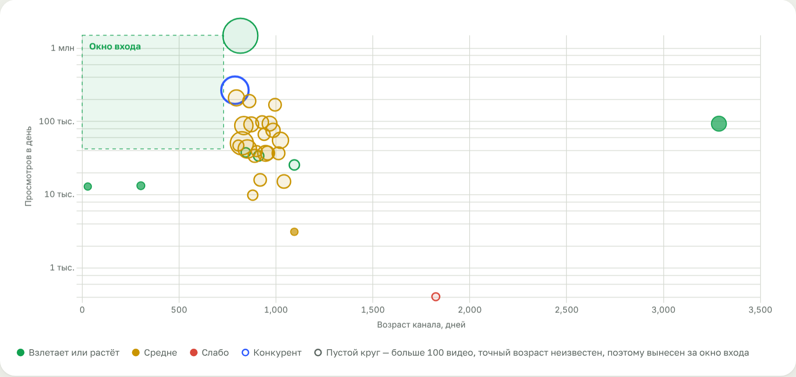

# Niche Finder — разведка ниши на YouTube

Вставляете ссылку на канал конкурента — сервис находит нишу, молодые каналы, которые уже набирают просмотры, и оценивает, насколько легко туда зайти.


## Что умеет

- **Оценка ниши от 0 до 100** и понятный вывод: заходить или нет. Учитывает спрос, конкуренцию, окно входа для новичков, монетизацию и свежесть.
- **Карта ниши** — все найденные каналы на одном графике: возраст × просмотры в день. Зелёная зона — окно входа.
- **Карточки каналов** с аватаром, оценкой роста, ключевыми цифрами и графиком просмотров последних видео.
- **Темы, которые выстрелили** — ролики молодых каналов, набравшие в разы больше обычного. Готовые идеи для первых видео.
- **Ключевые запросы ниши** с оценкой каждого.
- **Доступ по ключам** со сроком 1, 3, 10 дней или любым другим. Срок идёт с первого входа. Создавать и отзывать ключи может только администратор.
- История отчётов, ссылка на отчёт для коллег, выгрузка в CSV и PDF.

Работает на [yt-dlp](https://github.com/yt-dlp/yt-dlp): не нужны ключи YouTube API и платные сервисы.



## Установка за 2 минуты

| Где запускаете | Что сделать |
|---|---|
| **Windows** | Скачайте архив ([Code → Download ZIP](https://github.com/ravettikeney-sudo/youtube-niche-finder/archive/refs/heads/main.zip)), распакуйте и дважды щёлкните `START-WINDOWS.bat` |
| **Mac** | Скачайте и распакуйте архив, дважды щёлкните `START-MAC.command` |
| **Сервер Linux** | Одна команда: `curl -fsSL https://raw.githubusercontent.com/ravettikeney-sudo/youtube-niche-finder/main/install-server.sh \| sudo bash` |

Скрипт сам установит всё нужное и покажет **ссылку для коллег** вида `https://….trycloudflare.com`.

📘 **[Подробная инструкция по установке](docs/INSTALL.md)** — с картинками и ответами на частые вопросы.
👥 **[Инструкция для коллег](docs/COLLEAGUES.md)** — её можно просто переслать.

## Как это устроено

```
Коллеги ──(ссылка + ключ)──▶ публичная ссылка Cloudflare ──▶ ваш компьютер или сервер ──(yt-dlp)──▶ YouTube
```

Сервис работает в одном месте — у вас. Коллеги ничего не устанавливают: открывают ссылку в браузере и вводят ключ.

## Безопасность ключей

- В коде и в базе ключи хранятся только как хэши SHA-256. Восстановить ключ из них нельзя, поэтому репозиторий может быть публичным.
- Полный список ключей есть только у администратора, в отдельной таблице.
- 10 неверных попыток ввода ключа подряд — вход с этого адреса блокируется на 10 минут.
