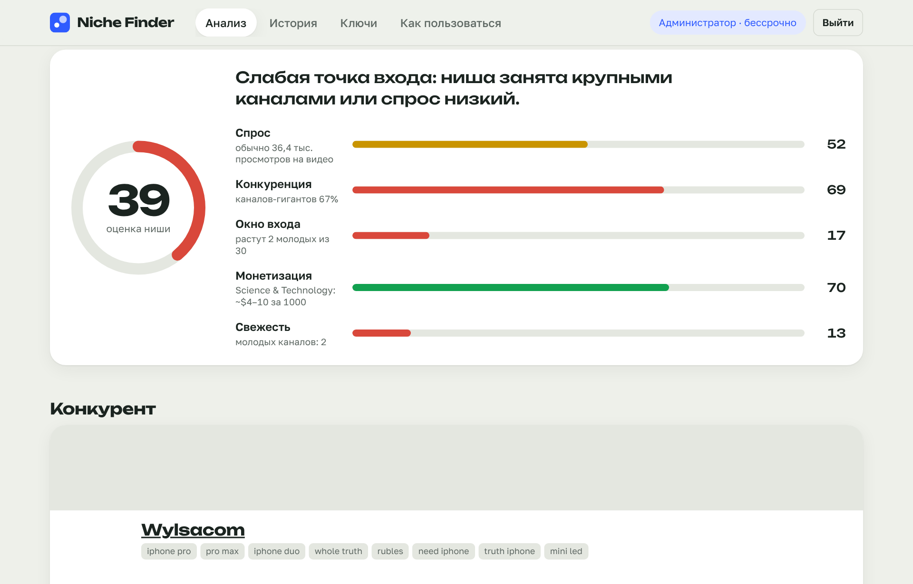
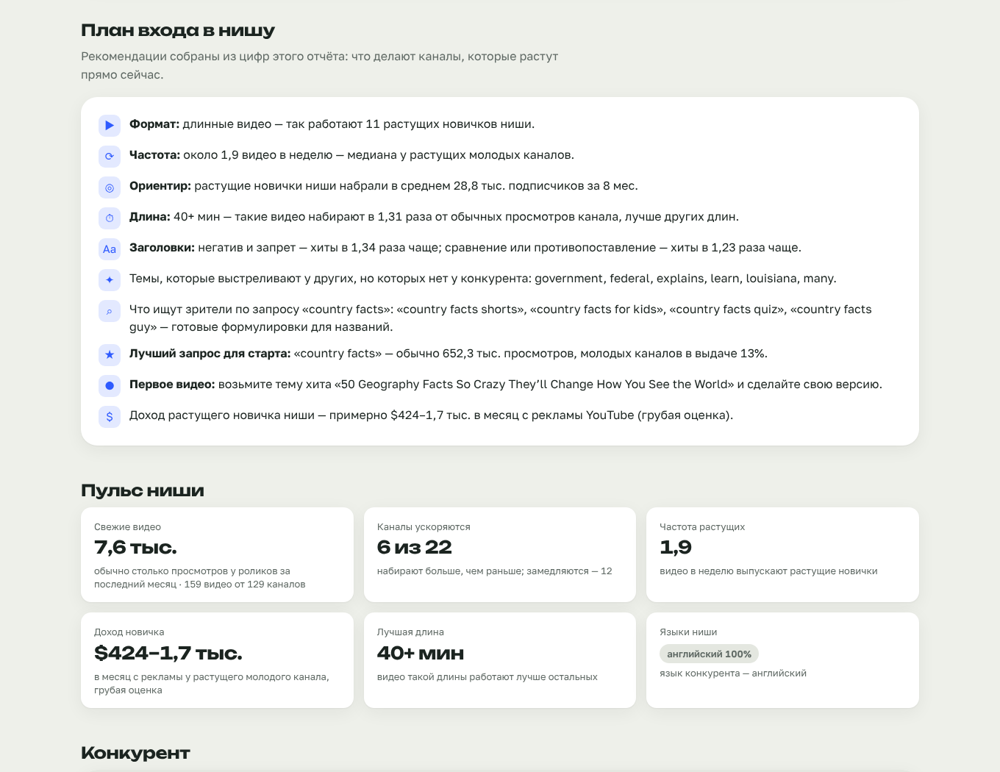
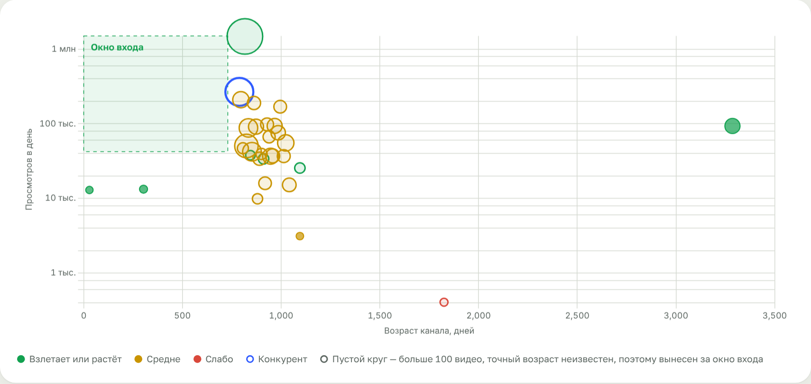

# Niche Finder — разведка ниши на YouTube

Вставляете ссылку на канал конкурента — сервис находит нишу, молодые каналы, которые уже набирают просмотры, и оценивает, насколько легко туда зайти.



## Что умеет

- **Оценка ниши от 0 до 100** и понятный вывод: заходить или нет. Учитывает спрос, конкуренцию, окно входа для новичков, монетизацию и свежесть.
- **Карта ниши** — все найденные каналы на одном графике: возраст × просмотры в день. Зелёная зона — окно входа.
- **Карточки каналов** с аватаром, оценкой роста, ключевыми цифрами и графиком просмотров последних видео.
- **Темы, которые выстрелили** — ролики молодых каналов, набравшие в разы больше обычного. Готовые идеи для первых видео.
- **Ключевые запросы ниши** с оценкой каждого.
- **План входа** — готовые рекомендации из цифр: формат, длина, частота выпуска, приёмы в заголовках, свободные темы, первое видео.
- **Пульс ниши** — сколько набирают свежие видео, сколько каналов ускоряется, языки ниши, примерный доход растущего новичка.
- **Какая длина видео работает** и **что работает в заголовках** — по тысячам роликов каналов ниши.
- **Что ищут зрители** — подсказки поиска YouTube по каждому ключевому запросу.
- **Точное попадание в нишу**: поиск идёт на языке канала-примера (русская ниша — русские каналы) и по названиям его лучших видео; у каждого канала видно «похожесть на конкурента» в процентах и общие темы. Случайные каналы помечаются «вне ниши» с причиной и не портят оценки. Язык и строгость можно поменять в настройках.
- **Несколько каналов-примеров** (2–3 ссылки через пробел) — общий профиль ниши точнее, чем по одному каналу.
- **«✕ Не та ниша»** на карточке канала: убирает его из отчёта и пересчитывает оценки; сохраняется в отчёте, можно вернуть.
- **Слова-исключения** в настройках (например, «гта, новости»): каналы и видео с ними не попадают в нишу.
- В карточке каждого канала: тренд (ускоряется или замедляется), доля хитов, длина видео, язык, примерный доход в месяц.
- **Разбор превью** — что заходит у вас и у конкурентов (их сервис находит сам) по реальным картинкам и просмотрам: лица, текст (распознаётся), цвета, стиль, приёмы в названиях — с оценкой надёжности каждого вывода. По сценарию нового ролика — варианты превью, промты для нейросети и названия к каждому варианту.
- **Поиск ниш по теме** — без канала-примера: тема → поднишы из ключевых слов каналов → рейтинг.
- **Shorts или длинные видео** — у каждого канала обе вкладки посчитаны отдельно.
- **Прогноз роста** на 3, 6 и 12 месяцев по реальным молодым каналам ниши.
- **Галерея хитов**, **сравнение ниш** бок о бок и **слежение за нишей** с еженедельным пересчётом.
- **Лимит анализов в сутки** на каждый ключ (тарифы 5/10/20/50/без лимита).
- **Открытый интерфейс и тарифы**: сайт можно посмотреть без ключа, а функции работают после ввода ключа или покупки. Тарифы и ссылки на оплату редактируются в админке — 💳 [как подключить оплату через Tribute](docs/TRIBUTE.md).
- **Доступ по ключам** со сроком 1, 3, 10 дней или любым другим. Срок идёт с первого входа. Создавать и отзывать ключи может только администратор.
- **Скачать для чата** — любой отчёт одним файлом со всеми данными, чтобы загрузить в ChatGPT или Claude.
- История отчётов, ссылка на отчёт для коллег, выгрузка в CSV и PDF. Коллеги видят только свои отчёты, администратор — отчёты всех ключей с фильтром по ключу.
- **Отдельный вход администратора** — `https://ваш-домен/admin`: открывается сразу на управлении ключами, обычные ключи там не принимаются.

Работает на [yt-dlp](https://github.com/yt-dlp/yt-dlp): не нужны ключи YouTube API и платные сервисы.





## Установка за 2 минуты

| Где запускаете | Что сделать |
|---|---|
| **Windows** | Скачайте архив ([Code → Download ZIP](https://github.com/ravettikeney-sudo/youtube-niche-finder/archive/refs/heads/main.zip)), распакуйте и дважды щёлкните `START-WINDOWS.bat` |
| **Mac** | Скачайте и распакуйте архив, дважды щёлкните `START-MAC.command` |
| **Сервер Linux** | Одна команда: `curl -fsSL https://raw.githubusercontent.com/ravettikeney-sudo/youtube-niche-finder/main/install-server.sh \| sudo bash` |

Скрипт сам установит всё нужное и покажет **ссылку для коллег** вида `https://….trycloudflare.com`.

📘 **[Подробная инструкция по установке](docs/INSTALL.md)** — с картинками и ответами на частые вопросы.
👥 **[Инструкция для коллег](docs/COLLEAGUES.md)** — её можно просто переслать.

## Как это устроено

```
Коллеги ──(ссылка + ключ)──▶ публичная ссылка Cloudflare ──▶ ваш компьютер или сервер ──(yt-dlp)──▶ YouTube
```

Сервис работает в одном месте — у вас. Коллеги ничего не устанавливают: открывают ссылку в браузере и вводят ключ.

## Безопасность ключей

- В коде и в базе ключи хранятся только как хэши SHA-256. Восстановить ключ из них нельзя, поэтому репозиторий может быть публичным.
- Полный список ключей есть только у администратора, в отдельной таблице.
- 10 неверных попыток ввода ключа подряд — вход с этого адреса блокируется на 10 минут.
