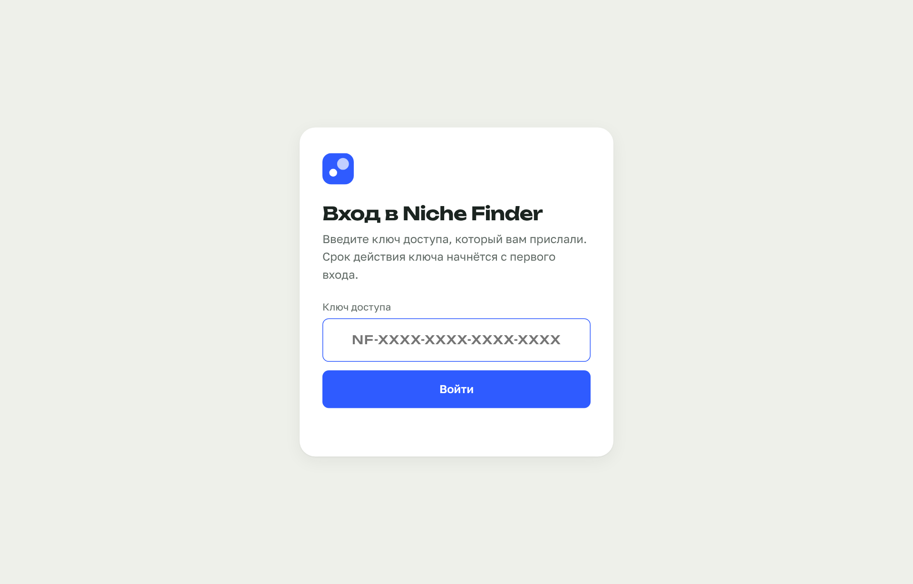
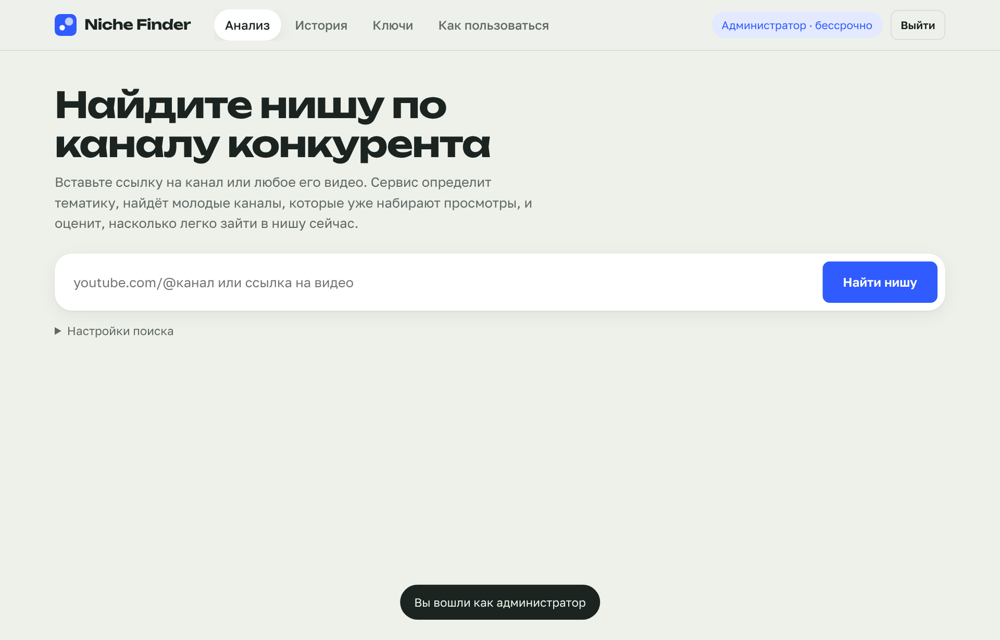
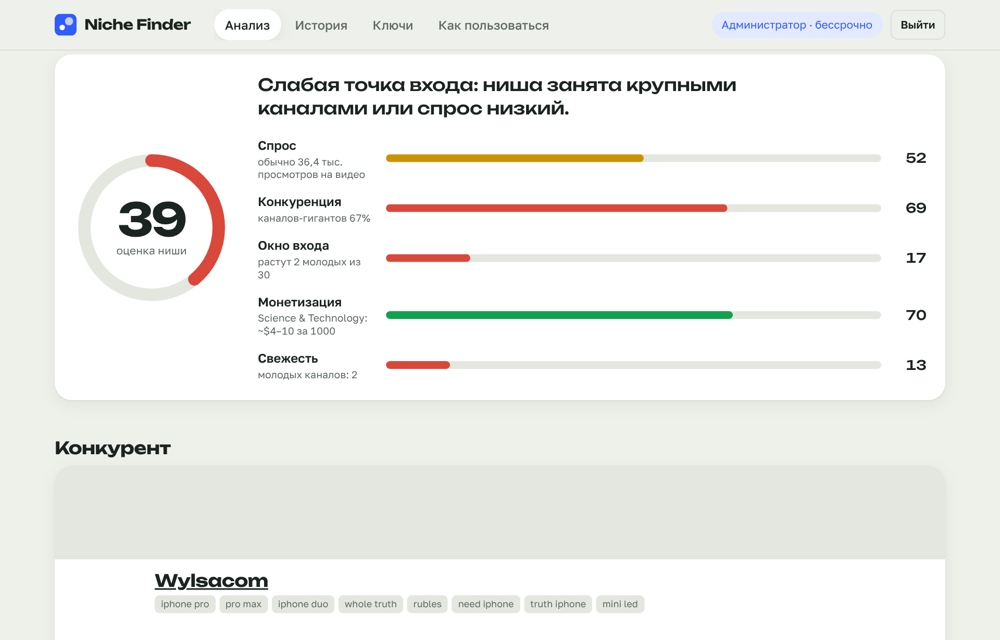
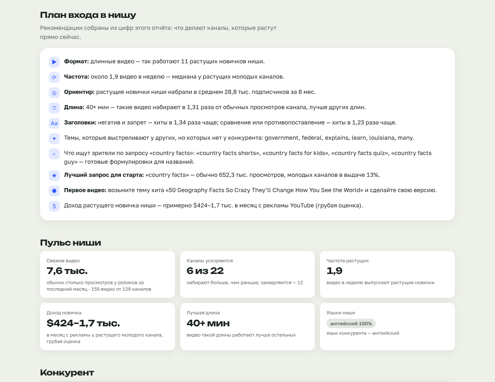
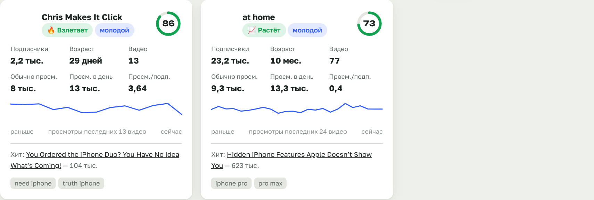
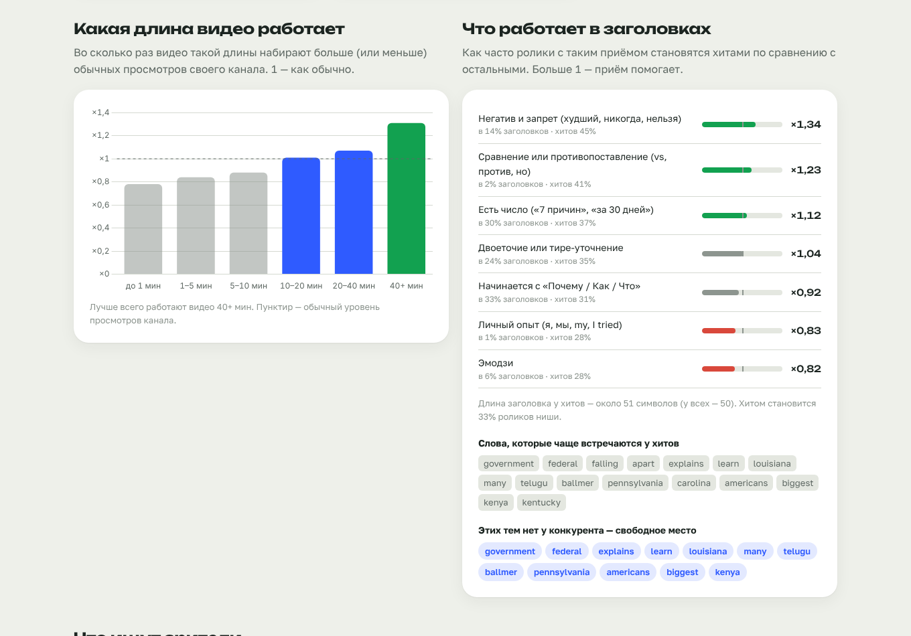
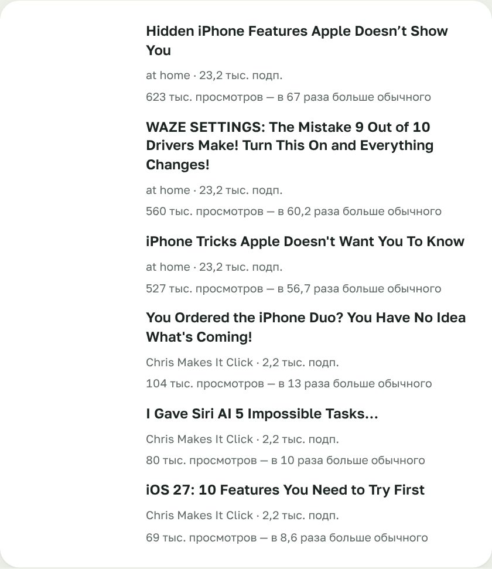

# Niche Finder — как пользоваться

Ничего устанавливать не нужно: сервис открывается в обычном браузере на компьютере или телефоне.

## 1. Войдите

Откройте ссылку-приглашение, которую вам прислали. Ключ подставится сам.

Если сервис просит ключ, вставьте его в поле. Он выглядит так: `NF-XXXX-XXXX-XXXX-XXXX`.

Срок ключа (сутки, 3 или 10 дней) начинается с первого входа. Сколько осталось, видно в правом верхнем углу.

## 2. Запустите анализ

Найдите канал, похожий на тот, который хотите делать. Вставьте ссылку на канал (`youtube.com/@имя`) или на любое его видео и нажмите **«Найти нишу»**. Анализ идёт 1–3 минуты.

## 3. Изучите отчёт

**Оценка ниши** — насколько выгодно заходить сейчас. 70+ — отлично, 55–70 — хорошо, 40–55 — средне, ниже 40 — сложно.

**План входа** — главное в отчёте: что делают каналы, которые растут прямо сейчас. Формат, длина видео, сколько выпускать в неделю, какие приёмы в заголовках работают, какие темы свободны и с какого видео начать.

**Пульс ниши** — сколько набирают свежие видео, сколько каналов ускоряется, на каких языках ниша и сколько примерно зарабатывает растущий новичок.

**Карта ниши.** Каждый круг — канал: левее — моложе, выше — больше просмотров в день. Зелёная зона — молодые каналы с хорошим темпом. Если там много кругов, новички в этой нише растут.

**Каналы ниши.** Карточки молодых и растущих каналов: подписчики, возраст, просмотры, тренд (ускоряется или замедляется), доля хитов, длина видео, примерный доход, график последних видео и самый успешный ролик. Каналы с пометкой «вне ниши» нашлись случайно и на оценки не влияют.

**Какая длина видео работает и что работает в заголовках.** Столбик выше пунктира — видео такой длины набирают больше обычного. Приём в заголовке с числом больше 1 помогает ролику стать хитом. Синие слова — темы, которых нет у конкурента.

**Что ищут зрители** — подсказки поиска YouTube. Это готовые формулировки для названий.

**Темы, которые выстрелили** — ролики молодых каналов, набравшие в разы больше обычного. Это лучшие идеи для первых видео.

## Советы

- Если ключевые слова подобрались неудачно, откройте **«Настройки поиска»** и впишите свои: 3–6 коротких запросов, как их набирал бы зритель.
- Сравните 2–3 канала одной темы, чтобы найти самую свободную поднишу.
- Все ваши отчёты сохраняются во вкладке **«История»**.
- Отчётом можно поделиться: кнопка **«Скопировать ссылку на отчёт»**. Открыть его сможет любой, у кого есть ключ.
- Если анализ завершился ошибкой, подождите пару минут и попробуйте снова.
- Срок ключа истёк? Попросите новый у того, кто дал вам доступ.
