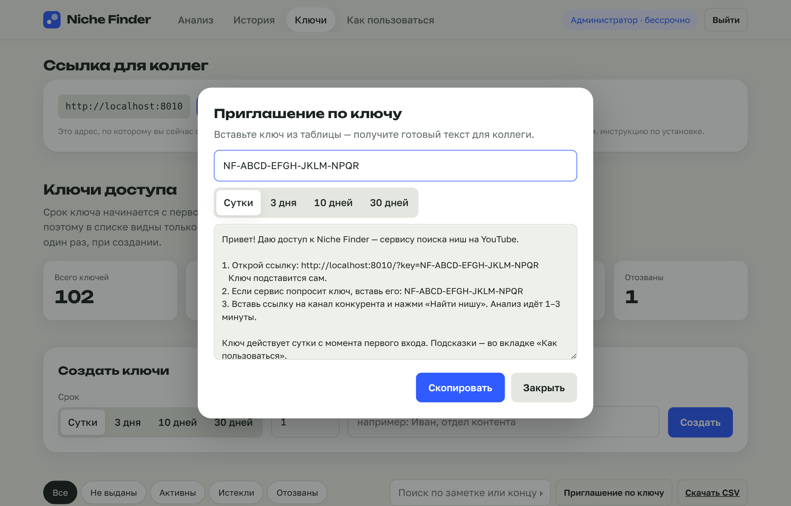
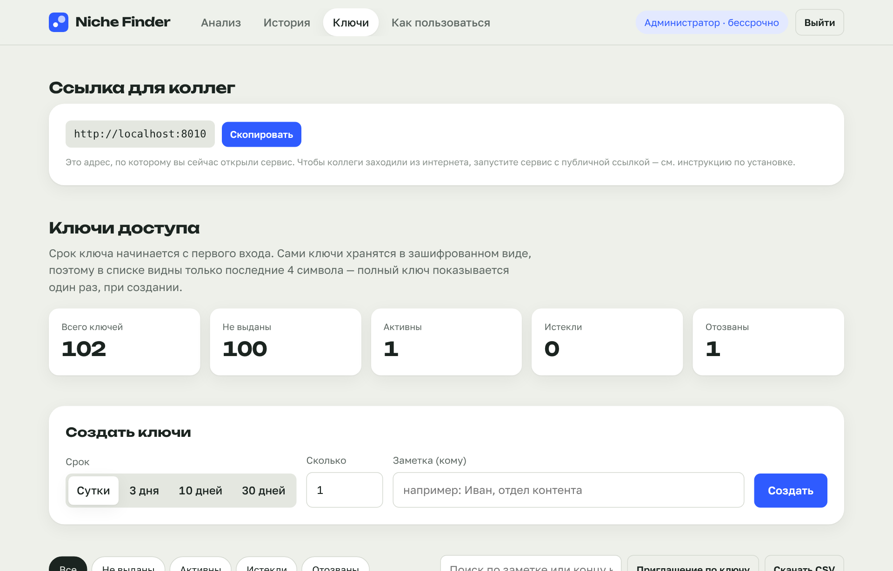

# Установка Niche Finder — подробно

Эта инструкция для **администратора** — того, кто запускает сервис и раздаёт ключи. Коллегам ничего устанавливать не нужно, для них есть [отдельная короткая инструкция](COLLEAGUES.md).

**Что понадобится**

- Компьютер или сервер, который будет включён, пока коллеги работают.
- Админ-ключ — он на листе «Админ» в таблице `Niche-Finder-ключи.xlsx`.
- 5 минут.

**Где лучше запускать**

| Вариант | Плюсы | Минусы |
|---|---|---|
| **Свой компьютер (Windows/Mac)** | Проще всего. Домашний интернет YouTube почти не блокирует | Сервис работает, только пока компьютер включён и окно открыто |
| **Сервер Linux (VPS)** | Работает круглосуточно, запускается сам после перезагрузки | Нужен сервер (от ~300 ₽/мес). YouTube чаще ограничивает серверы — см. раздел «Если YouTube блокирует» |

---

## Вариант 1. Windows

1. Откройте https://github.com/ravettikeney-sudo/youtube-niche-finder
2. Нажмите зелёную кнопку **Code** → **Download ZIP**.
3. Распакуйте архив. Удобно положить папку, например, в `Документы` или на рабочий стол.
4. Откройте папку и дважды щёлкните **`START-WINDOWS.bat`**.
   - Если Windows покажет «Система Windows защитила ваш компьютер», нажмите **Подробнее** → **Выполнить в любом случае**.
5. Подождите. Первый запуск занимает 1–3 минуты.
   - Если на компьютере нет Python, скрипт поставит его сам. После этого он попросит **закрыть окно и запустить файл ещё раз** — так нужно сделать один раз.
6. В окне появится строка **«Ссылка для коллег: https://….trycloudflare.com»**. Она уже скопирована, её можно сразу вставить в сообщение. Сервис откроется в браузере.
7. Войдите **админ-ключом** — вам откроется вкладка «Ключи».

> ⚠️ **Не закрывайте чёрное окно**, пока коллеги работают: закроете окно — сервис остановится. Окно можно свернуть.

**Следующие запуски** — снова двойной щелчок по `START-WINDOWS.bat`. Это занимает около 20 секунд. Ссылка при каждом запуске **новая**: её же видно во вкладке «Ключи» в блоке «Ссылка для коллег».

---

## Вариант 2. Mac

1. Скачайте архив так же, как в шагах 1–3 для Windows, и распакуйте его.
2. Дважды щёлкните **`START-MAC.command`**.
   - Если macOS пишет «не удаётся открыть, так как разработчик не подтверждён», щёлкните файл **правой кнопкой** → **Открыть** → **Открыть**.
   - Если нет Python 3.10+, откроется сайт python.org. Установите Python и запустите файл снова.
3. Дальше всё как в Windows: появится ссылка для коллег (она уже скопирована), и откроется браузер.

---

## Вариант 3. Сервер Linux — работает круглосуточно

Подойдёт любой VPS с Ubuntu 22.04/24.04 или Debian 12 и 1 ГБ памяти.

1. Подключитесь к серверу по SSH.
2. Вставьте одну команду:
   ```bash
   curl -fsSL https://raw.githubusercontent.com/ravettikeney-sudo/youtube-niche-finder/main/install-server.sh | sudo bash
   ```
3. Через 1–2 минуты появится **«Ссылка для коллег»**.

Сервис запускается сам после перезагрузки сервера и сам обновляет yt-dlp.

**Полезные команды**

| Команда | Что делает |
|---|---|
| `niche-finder url` | Показать текущую ссылку для коллег |
| `niche-finder restart` | Перезапустить сервис (ссылка поменяется) |
| `niche-finder update` | Обновить до последней версии, ключи сохраняются |
| `niche-finder logs` | Посмотреть журнал, если что-то не работает |

Если на сервере открыт порт 8000, сервис доступен и напрямую: `http://IP-сервера:8000`.

**Docker (для тех, кто с ним работает):** `docker compose up -d`. Ссылку покажет команда `docker compose logs tunnel | grep trycloudflare`.

---

## Как выдавать доступ

1. Откройте `Niche-Finder-ключи.xlsx` и впишите ссылку на сервис на листе **«Админ»** в жёлтую ячейку.
2. На листе **«Ключи»** выберите свободный ключ нужного срока: сутки, 3 дня или 10 дней.
3. Скопируйте из этой строки **«Ссылку-приглашение»** и отправьте коллеге. Ключ в ней уже есть, коллеге ничего не нужно вводить.
4. Впишите, кому выдан ключ. Строка станет серой.

Срок ключа начинается **с первого входа**, поэтому ключи можно выдавать заранее.

**Готовый текст приглашения** удобнее делать в самом сервисе: вкладка **«Ключи»** → **«Приглашение по ключу»** → вставьте ключ. Получится сообщение со ссылкой, ключом и короткой инструкцией.



### Что можно делать во вкладке «Ключи»



- **Создать новые ключи** на сутки, 3, 10 или 30 дней, сразу пачкой. Полный ключ показывается **один раз** — скопируйте его сразу.
- **Заметка** — записать, кому выдан ключ.
- **Продлить на 1 день** — если человеку нужно ещё время.
- **Сбросить срок** — отсчёт начнётся заново со следующего входа.
- **Отозвать** — доступ закроется сразу. Ключ можно вернуть.
- **Удалить** — навсегда.
- Видно, кто сколько раз входил и сколько анализов сделал. Внизу — последние анализы всех пользователей.

Админ-ключ **бессрочный**. Если он потерялся или попал к посторонним, напишите разработчику: ключ заменяется одним файлом `access/admin.sha256`.

---

## Если YouTube блокирует

Иногда анализ завершается ошибкой «YouTube не отдал данные» или «Sign in to confirm you're not a bot». Чаще это случается на серверах, реже — на домашнем компьютере.

1. **Подождите 10–30 минут** и запустите снова. Обычно блокировка временная.
2. **Перезапустите сервис.** При запуске yt-dlp обновляется до последней версии, а она часто уже умеет обходить новые ограничения.
3. **Cookies.** Установите в браузер расширение *Get cookies.txt LOCALLY*, зайдите на youtube.com (лучше с отдельного аккаунта Google), экспортируйте cookies в файл `cookies.txt` и положите его в папку сервиса. Затем:
   - Windows: в `START-WINDOWS.bat` перед строкой `[4/4]` добавьте `set YT_COOKIES_FILE=cookies.txt`.
   - Сервер: `sudo systemctl edit niche-finder`, добавьте строки `[Service]` и `Environment=YT_COOKIES_FILE=/opt/niche-finder/cookies.txt`, затем `niche-finder restart`.
4. **Прокси.** Переменная `YT_PROXY=http://логин:пароль@адрес:порт`. Лучше всего работают резидентные прокси.

---

## Частые вопросы

**Ссылка перестала открываться.** Сервис остановлен, компьютер уснул или выключен. Запустите сервис снова — ссылка будет новой. Чтобы компьютер не засыпал: Windows → Параметры → Система → Питание → «Переводить в спящий режим» → «Никогда».

**Можно ли сделать постоянную ссылку?** Да, два способа:
- сервер с открытым портом 8000 — адрес `http://IP:8000` не меняется;
- свой домен в Cloudflare и именованный туннель: <https://developers.cloudflare.com/cloudflare-one/connections/connect-networks/get-started/>. Если укажете ссылку в переменной `PUBLIC_URL`, она будет показываться во вкладке «Ключи».

**Где хранятся ключи и отчёты?** В папке `data` внутри папки сервиса. Её можно копировать как резервную копию. Если удалить `data`, все 100 стартовых ключей снова станут «не активированными», а созданные в админке ключи пропадут.

**Сколько человек могут работать одновременно?** Сколько угодно смотрят отчёты, а анализы выполняются по 2 одновременно — остальные ждут в очереди. Изменить можно переменной `MAX_PARALLEL_JOBS`, но чем больше параллельных анализов, тем выше шанс блокировки от YouTube.

**Как обновить сервис?** Windows/Mac: скачайте новый архив и перенесите в него папку `data` из старого. Сервер: `niche-finder update`.
